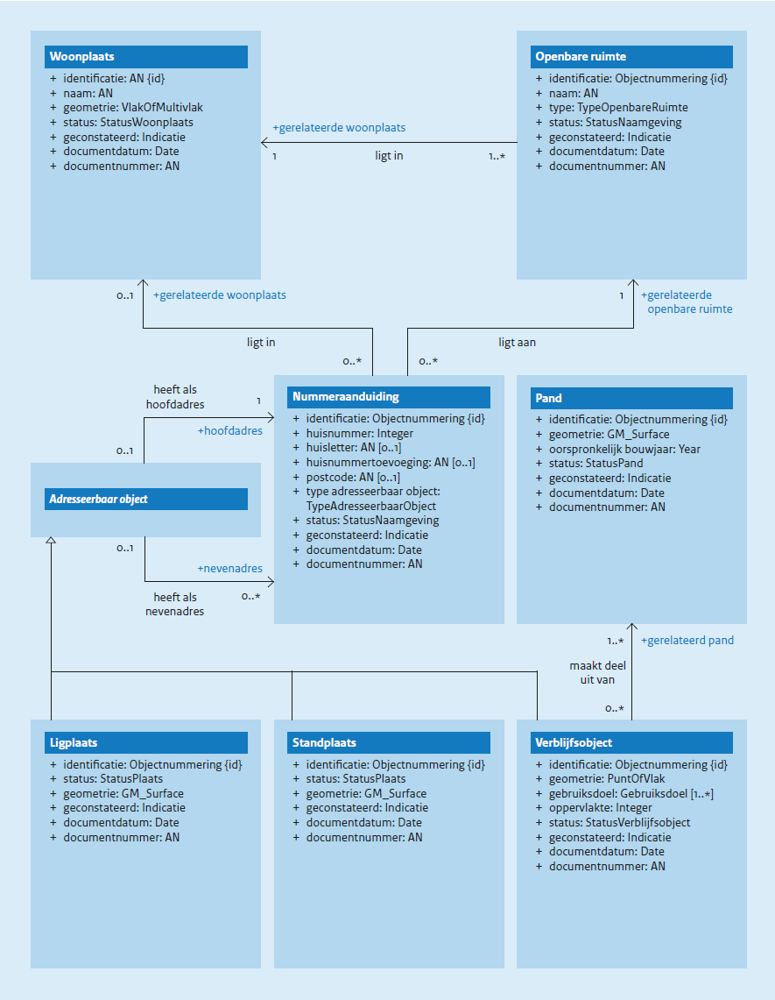

# Conceptueel model {#2C956665}
<a href='#d6aEbDbA'>Figuur 3</a> geeft een vereenvoudigde weergave van de conceptuele modellering van de BAG-objecttypen. De beschrijving van deze objecttypen staat in hoofdstuk 6 en die van hun eigenschappen in hoofdstuk 7 en hoofdstuk 8. De eigenschappen worden door alle BAG-objecttypen overerfd.  

Objecttypen met een schuingedrukte naam zijn abstracte objecttypen. Deze komen niet als concreet object voor in een BAG-product.  
<figure id='d6aEbDbA'></img>
<figcaption>Conceptueel gegevensmodel met objecttypen, attributen en onderlinge relaties</figcaption></figure>

